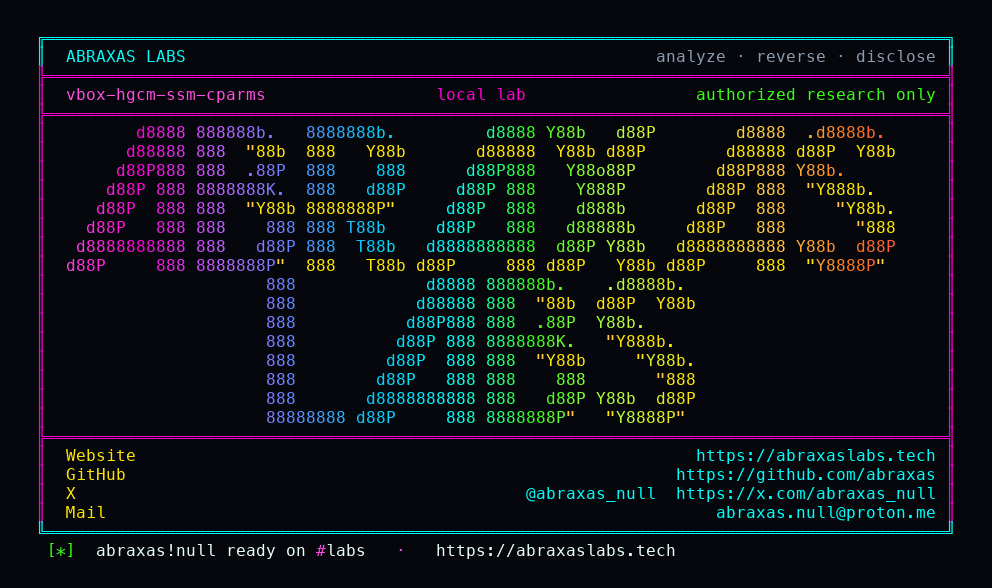

<p align="center">
  
</p>

<p align="center">
  <a href="https://abraxaslabs.tech"><strong>abraxaslabs.tech</strong></a>
  &nbsp;·&nbsp;
  <a href="https://github.com/abraxas">github.com/abraxas</a>
  &nbsp;·&nbsp;
  <a href="https://x.com/abraxas_null">@abraxas_null</a>
  &nbsp;·&nbsp;
  <a href="mailto:abraxas.null@proton.me">abraxas.null@proton.me</a>
  &nbsp;·&nbsp;
  <a href="https://github.com/abraxas/vbox-hgcm-ssm-cparms">vbox-hgcm-ssm-cparms</a>
</p>

# vbox-hgcm-ssm-cparms

**Class:** Heap overflow
**Reach:** Local (host)

**Oracle VM VirtualBox OSS** `7.2.20` (`f2792cf44`) - Oracle

Live HGCM still refuses `cParms > 32`. Saved-state load does not. `vmmdevR3HgcmLoadState` reads `cParms` from the `.sav` with no `VMMDEV_MAX_HGCM_PARMS` cap, then sizes the command with `uint32_t cbCmd`. At `cParms = 0x4000000` that product wraps to `sizeof(VBOXHGCMCMD)` (~120). The first `enmType` store is already a 4-byte write past the block.

**A host user who restores a hostile saved state overflows the VM-process heap. A guest cannot plant this through Save.**

| | |
|---|---|
| ID | no CVE yet |
| Class | **Heap overflow** (VM-process OOB write; not host-kernel escape) |
| Reach | **Local (host)** (UI:R saved-state / snapshot restore) |
| CWE | [CWE-190](https://cwe.mitre.org/data/definitions/190.html), [CWE-787](https://cwe.mitre.org/data/definitions/787.html) |
| CVSS | **High: 7.8** `CVSS:3.1/AV:L/AC:L/PR:N/UI:R/S:U/C:H/I:H/A:H` |
| Product | [VirtualBox OSS](https://github.com/VirtualBox/virtualbox) |
| Affected | **7.2.20** (`f2792cf44f663989818507e36d3db5f978523c5e`) |
| Auth | host user restores a Saved VM, snapshot, or `.sav` |
| License | [GNU Affero GPL v3.0](LICENSE) |
| Lab | `127.0.0.1` only. Source harness. No VirtualBox boot, no `.sav` parse. |

## What an attacker can do

Hand the operator a VM folder whose saved state carries a pending VMMDev HGCM CALL. They click Start on a Saved VM, restore a snapshot, or adopt the `.sav`. Console restore walks SSMR3 into `vmmdevR3LoadExec` into `vmmdevR3HgcmLoadState`. That is UI:R. The leftover is the parser, not a guest hypercall.

VMMDev is default-on. No 3D. No Guest Additions. No VRDP. Not PUEL.

### Method and sink

| Step | Where | What it grants |
|---|---|---|
| Restore | host UI / `VBoxManage startvm` on a Saved VM | The host user opens the hostile `.sav`. That is the only required click. |
| SSM unit | VMMDev `vmmdevR3HgcmLoadState` (`VMMDevHGCM.cpp:2043-2091`) | `SSMGetU32` into `cParms` with no `VMMDEV_MAX_HGCM_PARMS` (32) cap. |
| Alloc wrap | `vmmdevR3HgcmCmdAlloc` (`VMMDevHGCM.cpp:376-381`) | `uint32_t cbCmd = sizeof(VBOXHGCMCMD) + cParms * (40+24)`. `cParms = 0x4000000` wraps to ~120. `RTMemAllocZ` of that size succeeds against the heap budget. |
| First store | load loop `paGuestParms[i].enmType` (`VMMDevHGCM.cpp:2085-2091`) | `paGuestParms` is `pCmd + sizeof(VBOXHGCMCMD)`, which is already the alloc end after the wrap. The first type dword is a 4-byte OOB write. The stream only needs the CALL header plus one parameter type. It does not need 67 million records. |

### Privileges

| Kind | Provenance | What the attacker gets |
|---|---|---|
| Recon | none | Overflow bytes are sav-chosen. This is not a leak. Heap contents are not returned to the file. |
| Integrity | **lab-proven** | `cParms=0x4000000` wraps `uint32_t cbCmd` to 120. One `i=0` `enmType` store smashes a 0xA5 canary. `canary0=56424f58` is the `VBOX` prefix of `VBOX-HGCM-SSM-CPARMS-WITNESS`. Control `cParms=2` leaves the canary intact. |
| Integrity | inferred | Further sav-controlled parm records (type dword plus 32/64-bit or pointer-desc fields) write linearly off the ~120-byte `RTMemAllocZ` in VirtualBoxVM / VBoxHeadless. That is a write primitive in the VM process, same class as QEMU migration memcorr. This pack does not demonstrate instruction-pointer control. |
| Availability | inferred | VBoxVM crash if the smash is not turned into a controlled write. The harness is a canary smash, not a VirtualBox process crash. |

### What this leftover does not grant

- Not guest-to-host. Live `vmmdevR3HgcmCallAlloc` still rejects `cParms > 32` (`VMMDevHGCM.cpp:921-926`). A guest cannot plant the wrap through a legitimate Save.
- Host kernel. Other VMs. VBoxSVC.
- Host files. Windows restricted-token / AppContainer. Project Zero IDispatch 544666386 is public and is not this leftover.
- Live HGCM argument-size wrap (CVE-2013-5892 live sink). That entry is closed on this pin (`VMMDEV_MAX_HGCM_PARMS` 32, `VMMDEV_MAX_HGCM_DATA_SIZE` 128MiB).
- Sibling `offValue` / `cbValue` memcpy on complete is a second host-heap write only if HGCM clients restore in the same sav. It is not this lab.

Full host-user / host-kernel still needs a hardening leftover. Combining this smash with the public IDispatch bypass is discarded.

## How I found it

I pinned [VirtualBox/virtualbox](https://github.com/VirtualBox/virtualbox) tag `v7.2.20` peel `f2792cf44`. Live HGCM was the first read because CVE-2013-5892 was this class: argument-size wrap into `VBOXHGCMCMD`. The live path still has the cap:

```c
ASSERT_GUEST_STMT_RETURN(   cParms <= (cbHGCMCall - sizeof(VMMDevHGCMCall)) / cbHGCMParmStruct
                         && cParms <= VMMDEV_MAX_HGCM_PARMS,
                         LogRelMax(50, ("VMMDev: request packet with invalid number of HGCM parameters: ...")),
                         VERR_INVALID_PARAMETER);
```

Load does not. `vmmdevR3HgcmLoadState` takes `cParms` from the sav and calls the same allocator:

```c
const uint32_t cbCmd = sizeof(VBOXHGCMCMD) + cParms * (sizeof(VBOXHGCMGUESTPARM) + sizeof(VBOXHGCMSVCPARM))
                     + (enmCmdType == VBOXHGCMCMDTYPE_CONNECT ? sizeof(HGCMServiceLocation) : 0);
```

`AssertCompile` comments on this pin put CMD at 120, guestparm at 40, svcparm at 24. `cParms = 0x4000000` makes the 64-bit product `0x100000000 + 120`. The store to `uint32_t` keeps 120. Then:

```c
for (i = 0; i < cParms; ++i)
{
    VBOXHGCMGUESTPARM * const pGuestParm = &pCmd->u.call.paGuestParms[i];
    rc = pHlp->pfnSSMGetU32(pSSM, &u32);
    pGuestParm->enmType = (HGCMFunctionParameterType)u32;
```

`paGuestParms` sits at `pCmd + sizeof(VBOXHGCMCMD)`. After the wrap that is the alloc end. The first store is already OOB.

Wrong turns already recorded: treating live HGCM as the leftover (it still caps at 32); walking 67 million stores in the harness (the first dword is the proof); claiming a guest can plant this through Save; inflating VM-process heap smash to host-kernel escape; chaining public IDispatch.

Theatre: a reverse shell, a `.sav` parser, booting VirtualBox. The oracle is wrap plus a canary smash of `VBOX-HGCM-SSM-CPARMS-WITNESS`.

## Lab

```bash
cd lab
./run.sh
```

Or from the pack root:

```bash
python3 vbox-hgcm-ssm-cparms-Abraxas-Labs.py
```

Source harness on loopback **127.0.0.1:19210**. Compose project `vbox-hgcm-ssm-cparms`. `gadget.c` copies the pin sizes, the `uint32_t cbCmd` formula, the live 32 cap, and one load-path `enmType` store. It does not boot VirtualBox and it does not parse a `.sav`. Bind it to loopback.

```text
SUCCESS vbox-hgcm-ssm-cparms wrap=yes oob=yes live-cap=32 canary-smashed=yes VBOX-HGCM-SSM-CPARMS-WITNESS
```

## The fix

Cap SSM `cParms` at `VMMDEV_MAX_HGCM_PARMS` in `vmmdevR3HgcmLoadState` (and the pre-v17 `cLinAddrs` path) the same way `vmmdevR3HgcmCallAlloc` already does. Size `cbCmd` in `uint64_t` / `size_t` and refuse a wrap. A saved-state integer is not more trusted than a live guest integer.

## References

- [github.com/VirtualBox/virtualbox](https://github.com/VirtualBox/virtualbox) tag [v7.2.20](https://github.com/VirtualBox/virtualbox/releases/tag/v7.2.20) (`f2792cf44f663989818507e36d3db5f978523c5e`)
- [`VMMDevHGCM.cpp` live cap](https://github.com/VirtualBox/virtualbox/blob/f2792cf44f663989818507e36d3db5f978523c5e/src/VBox/Devices/VMMDev/VMMDevHGCM.cpp#L921-L926) · [alloc wrap](https://github.com/VirtualBox/virtualbox/blob/f2792cf44f663989818507e36d3db5f978523c5e/src/VBox/Devices/VMMDev/VMMDevHGCM.cpp#L376-L381) · [SSM load](https://github.com/VirtualBox/virtualbox/blob/f2792cf44f663989818507e36d3db5f978523c5e/src/VBox/Devices/VMMDev/VMMDevHGCM.cpp#L2043-L2091)
- [`VMMDEV_MAX_HGCM_PARMS`](https://github.com/VirtualBox/virtualbox/blob/f2792cf44f663989818507e36d3db5f978523c5e/include/VBox/VMMDev.h#L118)
- Leftover of [CVE-2013-5892](https://nvd.nist.gov/vuln/detail/CVE-2013-5892) class (live HGCM argument-size wrap)

## Contact

Abraxas Labs - [abraxaslabs.tech](https://abraxaslabs.tech) - [github.com/abraxas](https://github.com/abraxas) - [@abraxas_null](https://x.com/abraxas_null) - [abraxas.null@proton.me](mailto:abraxas.null@proton.me)
